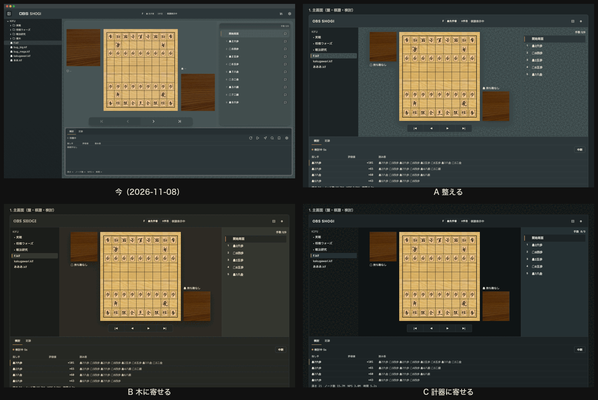

# 2026-11-08 の3案の比較

モード B。brief v0.2 から作った。**利用者が選ぶまで確定しない。** 選んだら理由を decisions/ に ADR で書き、モード C で本体へ反映する。案は消さない。

各案の見本は `2026-11-08-{a,b,c}/index.html`（主画面・プリセット編集・課題局面の3画面）。HTML と CSS は3案で同じで、違いはトークンだけ。盤と駒台は実物の画像（`2026-11-08-assets/`）。

## 雛形の指示から外したところ

- **3案で主色の色相をそろえた。** 雛形は「2案以上で同じ主色の色相を使わない」と指示するが、brief §0 の「今のイメージを保ったまま洗練させる」（利用者、2026-11-08）が優先する。3案は色相ではなく、洗練の向き（揃える／木に寄せる／計器に寄せる）でずらした
- **検討のドックと候補手のパネルは3案とも形を変えていない。** 利用者が「理想的でモダン」と言った部分（brief §0）。色だけがトークンに従って動く
- 書体は、題（`font.family.heading`）と見出し・注記（`font.family.label`）だけを案ごとに変えた。本文の書体と大きさの段階は本体の固定値（本文 13px 以上）に従って同じ

## 比較

| 案 | 一言 | brief との対応 | 強み | リスク | コントラスト検査 |
| --- | --- | --- | --- | --- | --- |
| A 整える | 今を正にして、ずれだけを揃える | スタイリッシュ＝今の対比、洗練＝ずれを無くす | 変化が最小で、今のイメージを確実に保つ | 「洗練された」と感じる差が小さい。盤面の背景色の答えが「揃える」だけ | 合格（29組、最小 4.56:1）。今の製品の不足2つを直した |
| B 木に寄せる | 枠の色温度を盤と駒台の木に合わせる | authentic・リッチ（§3）、タイトル戦の盤駒 | 盤と駒台が最も引き立つ。利用者の「リッチで authentic」に最も近い | 明朝の題が和風の装飾に寄る危険（§7）。検討ドックの色が少し温まる | 合格（29組、最小 4.89:1） |
| C 計器に寄せる | 枠を深く冷たくし、盤を暗い台に浮かせる | 開発者の道具（IDE・計器）（§3） | 検討ドックの表の性格と最も地続き。盤が浮く | 冷たい枠と木の対比が強すぎる恐れ。等幅の見出しは日本語で間延びしやすい | 合格（29組、最小 4.79:1） |

検査は `npm run ds:check -- --dir explorations/2026-11-08-<a|b|c>`（トークン、トークン外の値、コントラスト、axe）。3案とも全項目合格。

## 見本で見つけた、今の製品の不足

A の見本に axe をかけて見つけた。**今の製品の値のまま**なので、どの案を選んでも本体を直す必要がある。

| 組み合わせ | 今の比 | 起きる場所の例 |
| --- | --- | --- |
| 説明文の色（`color.text.subtle` `#b9b7ac`）× 棋譜の面（`color.background.canvas` `#3f4e4f`） | 4.32:1 | 選ばれた行の中の注記・バッジ |
| 失敗の文字（`color.feedback.danger.text` `#c98a83`）× 本文の背景（`color.background.default` `#2c3639`） | 4.39:1 | フォームの入力の断り（「数値を入力してください」） |

本体の `contrast-pairs.json` はこの2組を持っておらず、検査で拾えていなかった。

## 混ぜ方の例

混ぜてよい（雛形の手順5）。たとえば「A の形と配色に、B の盤の面（焦げ茶）だけを入れる」、「A に、C の盤の面（いちばん深い色）だけを入れる」。盤面の背景色は利用者が名指した見直しの項目なので、ここだけを B か C から取る混ぜ方が素直。
